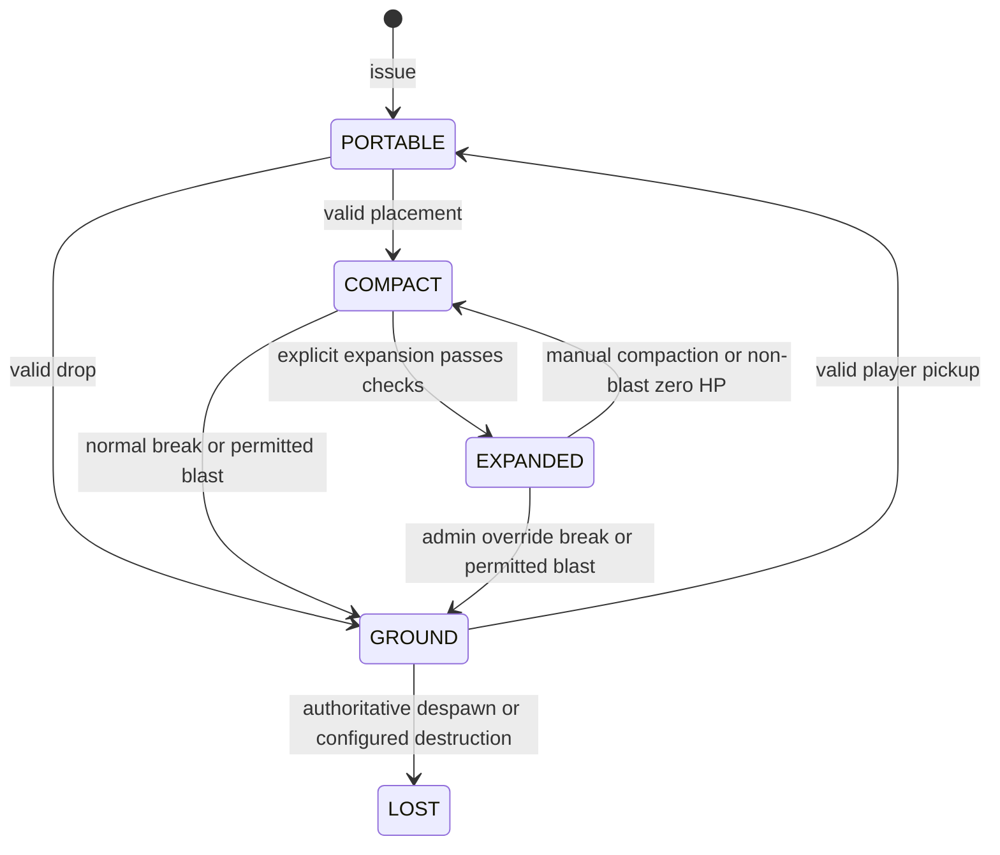

# Inferno Lantern Technical Solution

Status: Proposed technical design for prototype and implementation planning. Not an implemented
plugin or a compatibility guarantee.

Date: 2026-11-13

Requirements: [Requirements](REQUIREMENTS.md).

## 1. Design Boundary

Build a standalone Paper plugin providing configurable compact/deployed lantern variants, real
lighting, ordinary-mob defence, HP repairs, identity persistence, and rewards. Keep server
artwork, reward eligibility, and quantities in deployment configuration. No runtime dependency,
detection, API call, or adapter connects this plugin to an acquisition-gating system. External
administrators may separately configure generic acquisition rules using documented variant
identifiers.

This solution selects internal boundaries and proposes algorithms. The product name is Inferno
Lantern. It does not select final commands/permission nodes, Minecraft version, full geometry,
damage balance, or protection provider. Decisions requiring product approval or experimental
evidence are listed in section 12.

Initial feasibility target: Paper with both Java and Geyser/Bedrock clients in the same test
environment. Folia remains a later support gate. Direct boss targeting/combat, permanent
deletion/refunds, built-in trusted players, crafting/trade integrations, and a separate fuel
system are excluded. Incidental Wither explosions and independent dragon-kill rewards remain in
scope.

## 2. Components

| Component | Responsibility |
| :--- | :--- |
| Variant catalog | Validate effective settings, immutable configuration revisions, durable retired definitions. |
| Tower service | Serialize per-tower state transitions and enforce invariants. |
| Repository and operation journal | Authoritative HP, item generations, deployed revisions, awards, pending effects, restart reconciliation. |
| Item service | Issue unique items, validate tokens, track ground entities, reject stale copies, prevent automated collection. |
| Structure service | Compact base, reserved footprint, rendering/hitboxes, component manifests, compaction and cleanup. |
| Access policy | Native permissions, current controller, world/fluid rules, explicit session override, supported protection checks. |
| Repair service | Menu sessions, resource escrow, payment/HP transaction and cooling locks. |
| Combat service | Target selection, mob retaliation, incoming damage, damage deduplication, blasts and health indicators. |
| Presentation | Java/Bedrock asset identifiers, pack delivery, messages, menus, particles and sound. |
| Reward service | Idempotent admin/tester awards and optional dragon outcome input; durable initial delivery. |

Internal services may expose interfaces to one another. These boundaries do not establish an
external acquisition-gating integration contract.

## 3. Authoritative Data

Proposed initial storage is a local transactional SQLite database with versioned migrations, a
serialized writer, and bounded in-memory read snapshots. Benchmark it at the target load before
final selection. Do not perform disk/network work on the server's world thread or access live
world/player objects from database threads.

| Record | Essential fields |
| :--- | :--- |
| Variant definition | Stable ID, definition revision, validated settings, ACTIVE/RETIRED status, last valid definition. |
| Tower | UUID, variant ID, HP, lifecycle, item generation, deployment revision, controller UUID or null, world UUID/base position/orientation or null, player switch choices, expand-after and repair-after timestamps, row version. |
| Ground representation | Tower UUID, generation, entity UUID, world/chunk, delivery operation ID, lifecycle status. |
| Structure manifest | Tower UUID, deployment revision, component identifiers, occupied positions, original block/fluid states, expected plugin-owned replacement states. |
| Operation | Unique operation ID, tower UUID, expected row version/revision, before/after state, intended effects, durable phase, reconciliation evidence. |
| Award | Unique source event/campaign and recipient key, variant, quantity, unique tower IDs, pending/delivered status. |
| Repair escrow | Operation ID, tower/revision, contributor UUID, exact resource stacks, payment and HP-application phases. |

An item contains a schema version, stable variant identifier, tower UUID, and representation
generation/token. It does not own the authoritative HP, cooldown, or controller data. Cached
lore is informational. Every issued tower is unique and non-stackable; splitting/merging must
not create new identities. Never identify a reward by display name alone.

Portable items may be in a player inventory or ordinary storage. Transfers between these
locations do not assign ownership. A dropped entity is a distinct authoritative representation
with its own UUID. No exhaustive holder tracking is required just to move an item manually
between inventories, but all mutations into/out of ground or world form require validated
transitions.

Exact duplicated portable items are indistinguishable until a validated action commits. First
valid action wins; competing copies become stale. Cryptographic signatures may prevent arbitrary
token forgery if later warranted, but cannot distinguish exact copies and are not a substitute
for the ledger.

## 4. Lifecycle and Invariants

Persisted stable states are PORTABLE, GROUND, COMPACT, EXPANDED, and LOST.
TRANSITIONING/RECONCILING represents incomplete operations, not a usable additional tower.
ACTIVE/RETIRED is a variant status orthogonal to tower form. Unloaded is runtime suspension, not
compaction or loss.

| Transition | HP/control/timer effects |
| :--- | :--- |
| Initial award | Zero HP, null controller, no expansion cooldown; one identity per unit awarded. |
| Placement | Consume portable generation; COMPACT has null controller; preserve HP/timers. |
| Expansion | Require HP percentage and expand-after time; record actor as controller and new deployment revision; consume no HP. |
| Manual compaction | Current controller or explicit admin override; stop services, clear controller, set expand-after = now + duration. Leave placed compact base. |
| Non-blast damage reaching zero | Same compaction effects, zero HP, refresh repair lock. No item delivery. |
| Compact breaking | Native permission + world protection; one ground item, preserve HP and existing timestamps. |
| Admin expanded breaking | Explicit override, remove all components, clear controller, fresh expansion cooldown, one ground item. |
| Permitted blast | Apply damage once, clamp HP at zero, remove affected tower, one ground item. Fresh cooldown only if expanded; refresh repair lock on positive damage. |
| Player pickup | Validate current entity/generation, retire ground representation, new portable generation. No permission-based pickup check in this plugin. |
| Item destruction | Only current ground entity/generation may become LOST; stale entity events cannot expire a newer representation. |

Invariant checks:

- At most one usable authoritative form per tower. Never both a live structure and a valid
  portable item.
- Controller is present only while expanded, including restart suspension of an expanded tower.
  Compaction clears it; no permanent ownership.
- HP is finite and within the validated maximum. Damage lowers it; payment raises it; deployment
  never spends it.
- Every component, menu action, scheduled hit and delayed cleanup carries tower UUID plus
  deployment revision. Old revision callbacks cannot change a newer deployment, even if the same
  player expanded both.
- Compaction/recovery cooldown is per tower and survives transfer, restart, and compact
  placement. Duplicate callbacks cannot restart it.
- Session override never resets state, creates identities, waives payment/cooling, or bypasses
  clearance/integrity.
- Physical breaks always drop one item, never insert it directly into inventory. Initial award
  delivery is a separate workflow.

Reject stale placement without consuming/deleting the rejected item. Use private feedback
including “Please contact an admin.” Never automatically refund a stale copy as a new tower.

## 5. Durable Transitions and Thread Ownership

A database transaction cannot atomically commit Minecraft world/player saves. “Atomic
transition” here means a serialized durable intent with idempotent effects and verified
reconciliation, not an impossible shared transaction across the database, inventories and chunk
files.

Proposed protocol:

1. On the appropriate world/entity scheduler, capture the requested action, exact source
   representation, revision, actor and relevant snapshots. Cancel the default mutation/drop
   where necessary; freeze the affected representation during the operation.
2. Serialize the tower operation, check its expected row version, and durably record intent. Do
   not hold a world thread waiting for database I/O.
3. Return to the owning scheduler, verify revision, authorization, source inventory/entity and
   world preconditions again, then apply named effects tagged with the operation ID. Reschedule
   instead of reaching across unsupported thread boundaries.
4. Commit completion and publish the new read snapshot. Release reservations only when
   completion or rollback is known.
5. On a mismatch, perform a documented compensating action only when ownership/evidence proves
   it safe. Leave ambiguous operations RECONCILING, stop their combat, and report them for
   administrative resolution. Do not guess by spawning another item or granting another payment
   refund.

Startup reconciles journals before enabling tower mutations/combat. Reconcile manifests as
chunks/entities/players become available; do not force-load every world to declare an absent
tower lost. Expected unloaded entities are not despawned items. Durably persist item-delivery
intent before structure removal, then locate the operation-tagged drop on recovery before
creating a replacement. Preserve item age/remaining despawn lifetime when repairing an
interrupted delivery; startup must not repeatedly grant a full new lifetime.

Test interruption before and after every effect boundary, including database durability versus
player/chunk save order. If the prototype cannot resolve a phase automatically without
duplication/loss, document the bounded quarantine/admin repair path rather than advertising
exactly-once physical delivery.

Paper is the first runtime. Use a scheduler abstraction and region-local snapshots early; Folia
support requires separate cross-region tests and correct entity/region scheduling, not just a
descriptor flag. [Paper scheduling guidance](https://docs.papermc.io/paper/dev/folia-support/)

## 6. Placement, Structures, Lighting and Clients

The first feasibility experiment must compare representations for: one-block compact placement,
declared collision volume, visible expansion, real light, zombie pathfinding/attacks, safe
removal, and Java/Bedrock rendering. A clickable display alone is insufficient.

Candidate A combines mapped block geometry with a separate targetable living proxy. Candidate B
combines supported visual entities with explicitly managed collision/target components. Neither
is selected until it passes the same tests. Do not assume Java display entities or a living
proxy are rendered, targeted, or damaged equivalently through Geyser. Prevent any proxy from
spawning loot, awarding XP, burning, suffocating, walking away, or dying independently of tower
HP; unsupported environmental behaviour is a prototype failure.

Before expansion reserve the entire oriented volume and recheck native permissions, HP,
cooldown, variant status, configured worlds, actual dimension, world bounds, loaded chunks,
solids, entities, fluids, other structures, and supported protection providers.
Cross-chunk/cross-region geometry is a dedicated concurrency gate. Reject unsupported
arrangements privately rather than partially deploying.

Store original block/fluid states and expected plugin-owned states. Cleanup restores only
positions still owned by that tower/revision; it must not overwrite later unrelated changes.
Proposed first implementation rejects piston movement of tower components rather than moving a
multi-component ledger, subject to prototype confirmation. No physical artifact should survive
recovery as an invisible Wither cage. Do not guarantee general anti-trapping beyond tested
footprints and permitted exposure.

Real illumination must be explicitly provided, not inferred from emissive textures. Select a
light-source implementation alongside the representation; persist/clean up its occupied
positions and verify light values and water/lava cases. Preserve baseline fluids and reject
unsupported waterlogged/flowing combinations without converting or draining terrain.
Submerged-combat detection at the attack head remains a proposal to test.

Pack strategy: generic assets per variant and compact/deployed state; server branding overrides
stable documented asset paths. Support default delivery, stacking, and complete combined packs
with automatic delivery disabled. Keep text in configuration. Delivery failures must prevent
unsupported custom interactions, with visible feedback and a documented server-managed readiness
path. Bedrock needs its own assets and item/block mappings; Geyser does not generate them
automatically. [Geyser item mapping](https://geysermc.org/wiki/geyser/custom-items/), [Geyser
block mapping](https://geysermc.org/wiki/geyser/custom-blocks/)

PDC is suitable for compact item identity fields and supported entity/component markers; placing
an item does not automatically preserve its data on the block. Use the repository and explicit
structure mapping. [Paper PDC documentation](https://docs.papermc.io/paper/dev/pdc/)

## 7. Access and Configuration

Native action eligibility is required for place, expand, repair, switches, compact, and break.
No configured variant permission means ordinary public access, subject to other checks. A
compact base has no controller. Expanded repair/switch/compaction additionally requires its
current controller; ordinary direct expanded breaking is always denied, including for that
controller. Explicit admin override permits direct expanded recovery and the agreed
controller/cooldown bypasses only.

Override is in-memory, actor-specific and session-bound. Permission alone never enables it.
Toggle it explicitly, log bypassed actions, give status feedback, clear on logout/disconnect,
and never restore it at startup. Recheck administrative authorization at commit. Keep override
hints private and show them only to authorized administrators.

Block hopper and hopper-minecart pickup without changing item generation. Do not infer
permissions for machines. Player pickup/storage withdrawal permission enforcement is exclusively
a separately configured external policy. Generic automation beyond tested vanilla cases is
unsupported, not silently treated as safe. Native lifecycle checks still apply regardless of
external plugins.

| Configuration group | Effective policy |
| :--- | :--- |
| Capabilities | Server defaults with per-variant overrides; both available by default. Player on/off preference cannot activate disabled light/defence. |
| HP/repair | Variant maximum, threshold default 50%, resource rates and cooling duration; no hardcoded diamond requirement. |
| Deployment | Geometry, expansion cooldown, private feedback; no home/claim-age or gameplay count limits. |
| World filters | Optional world/dimension allowlists and world denylist; explicit empty allowlist permits none, deny wins. Use world UUID in placed records. |
| Fluids | Water placement/expansion allowed, submerged combat disabled; lava placement/expansion/combat disabled by default. |
| Ground items | Fire/lava survival and floating by default; configurable burning; normal despawn by default, configurable no despawn. |
| Blasts | Configured resistance/multiplier, respect tower protection default true. Mixed provider/exposure handling is a pre-implementation gate. |
| Combat | Supported ordinary entities and targeting mode, range, rate, damage, particles; PvP off by default. |

Validate finite numeric values, non-negative durations, known resources/models, and 0 <
threshold <= 100. Publish an immutable effective config revision only after complete validation.
An invalid change retains the previous valid settings with console diagnostics; it must not stop
the server. First-run irrecoverable configuration/storage errors disable unsafe lantern
operations with diagnostics, not the entire server.

Missing variants retire using their durable last valid definition. Pause new awards, expansion,
light and defence; preserve controller and permit authorized compaction/breaking. Hold initial
pending awards while retired, without marking them delivered; resuming the same ID may resume
claims after validation. Reject or defer geometry changes for existing expanded instances; their
stored manifest is authoritative for cleanup. Proposed HP migration clamps values above a
reduced maximum and never heals on increasing the maximum; final migration policy requires
sign-off before a production configuration migration.

## 8. Repair and Resource Transactions

Menus bind actor, tower UUID, lifecycle/deployment revision and config revision. A menu that
outlives compaction/re-expansion cannot submit against a newer revision. Revalidate HP, cooling,
eligibility, selected resources and controller at commit.

Proposed implementation uses a payment preview and explicit Repair action with an escrowed input
slot. Consume only accepted configured items in whole units; compute HP using fixed-point units
or another deterministic representation. Never accept more than the useful payment shown in
preview. Final partial-item/rounding policy remains a product gate; do not silently consume an
entire stack. Close/disconnect returns unconsumed escrow through a durable return record, never
an untracked duplicate refund.

Lock repair while a valid tower attack executes and until repair-after has elapsed since the
most recent attack or positive incoming damage. No target acquisition or toggling alone counts
as a damaging attack. A target still under active attack prevents repair even between scheduled
hit ticks. Compaction/removal stops attack activity but preserves repair-after. Repairing never
resets expand-after; passing the threshold does not auto-expand.

Escrow resource debit, HP application and refunds use the journal protocol in section 5. If
server/player saves disagree after a crash, keep that transaction unresolved for evidence-based
reconciliation rather than both restoring resources and applying HP. Prototype tests must cover
simultaneous viewers, click/shift/number-key/drag gestures, damage during payment, disconnect,
full inventory and restart.

## 9. Combat and Explosion Routing

Prove one zombie path first: acquisition, retaliation after an actual tower hit, one melee
debit, repair lock, and normal target release after compaction. Paper offers custom goal
management, but each supported mob needs verification. [Paper mob
goals](https://docs.papermc.io/paper/dev/mob-goals/)

Use bounded scheduled scans and a stable target lease per tower, not every-tick global scans.
Modes are normal, retaliation, and tower priority. Proposed arbitration keeps a reachable
current aggressor until its lease expires, then uses a documented deterministic tie-break;
duration and exact selection need prototype validation. Remove only plugin-owned target
goals/leases and restore appropriate vanilla behaviour without overwriting newer unrelated
plugin targets. Bosses are rejected from target configuration. Optional PvP requires its own
protection/provider tests and excludes the current controller.

Each incoming hit carries tower ID, source component, deployment revision, source event identity
and damage classification. Resolve protection before applying a serialized HP update.
Deduplicate overlapping components for the same attack without suppressing distinct simultaneous
attackers. Stale proxy/projectile callbacks cannot hit a later deployment. Suppress native proxy
health/death effects when custom HP is authoritative. Select beam damage type and any potion
mappings explicitly; cosmetic fire must not silently imply damage semantics.

For explosions, gather candidate towers by actual affected component/damage volume, deduplicate
by identity, and compute exposure with the chosen representation. Before implementing production
blasts, select a single policy for mixed entity/block permission decisions. Respecting
protection defaults to leaving a denied tower unchanged; disabling that setting affects only
tower state, never uncancels the global explosion. Do not derive exposure solely from a
block-destruction list if the representation is damageable entities, or solely from a damage
event if compact bases lack such an entity.

For each permitted affected tower, use one journaled damage-and-ground-drop operation. Remaining
HP = max(0, prior HP - applicable blast damage); resistance may reduce HP damage but cannot
alone make the affected structure remain as a cage. Expanded towers clear controller and start
cooldown; compact towers preserve existing cooldown. No intermediate placed compact base is
exposed. Emit the single compact item after the originating explosion is resolved, or otherwise
tag it to exclude only that explosion. Do not grant indefinite explosion invulnerability. Test
chained explosions, a blast also reaching zero HP, protection denial, Wither spawn blast, and
normal item survival/expiry afterward.

Compact bases break as ordinary blocks for eligible players; normal breaking is not an HP
payment. Incoming compact-base melee/projectile damage behaviour is a remaining product
decision. Do not invent a second recovery path while implementing it.

## 10. Rewards and Standalone Operation

An award produces individually identified zero-HP towers. Use idempotency keys for
campaign/recipient/variant and dragon encounter/recipient/variant. Quantities are independent
configuration, not reward-specific code. Initial delivery into inventory is journaled and uses
pending storage for full/offline recipients; physical recovery always uses ground drops.
Missing/retired variants keep pending awards paused.

Lantern issuance does not itself grant external permissions or call an acquisition-gating
system. A trusted administrative workflow grants eligibility separately. Select the dragon
encounter source and qualifying participants before building that adapter. If an encounter
provider is needed, document that dependency separately; it is not permission-plugin coupling.
Do not grant kill/progression credit to a player just because they expanded a tower without an
approved attribution policy.

Standalone installations may permit acquisition by anyone while denying use without permission.
Document that distinction and do not label the native usage checks as an acquisition lock.

## 11. Validation Gates

| Gate | Evidence required |
| :--- | :--- |
| G0: rendering and mob feasibility | Same compact/deployed variant seen and operated on Java and Bedrock; real light; one zombie targets and damages it once per hit; compaction releases target and cleans proxy/collision/light. |
| G1: lifecycle integrity | Competing/stale copies, manual chest storage, ground pickup/drop, stale expiry, blocking hoppers, unload/restart, chunk/player save mismatches and operation-journal fault injection. |
| G2: gameplay policy | Temporary controller rights, all compaction paths, HP/repair/cooldown, no passive bypass, session logout reset, capability/world changes and retirement. Production fluid-change evidence belongs to G3. |
| G3: combat/environment | Verified mob matrix, line of sight, incoming damage, potion policy, permitted/denied/chained blasts, Wither blast drops without direct boss combat, world/fluid cleanup. |
| G4: delivery and compatibility | Idempotent initial rewards, pack variants/overrides and failures, mobile escrow gestures, full inventory, multiple simultaneous towers and measured tick/DB workloads. |
| G5: release readiness | Selected versions and provider contracts, final defaults, configuration/recovery documentation, controlled Java/Bedrock playtest, and recorded compatibility evidence. |

No blanket compatibility claim follows from a document or passing unit tests. Record exact
builds, client versions, model strategy and supported provider versions when tests are executed.

## 12. Decisions and Deferred Work

| Decision | Must be settled before |
| :--- | :--- |
| Supported server/client versions and command/permission names | Public runtime interface; repository and GPL-3.0 license are selected. |
| Compact/expanded rendering, collision, damage target, real-light implementation and dimensions | Finishing G0; do not build final packs/reward logic first. |
| World selector syntax, submerged detection, provider-specific blast precedence/exposure | World/fluid/blast implementation. |
| Repair final-item rounding, cooling defaults, maximum HP migration, compact non-blast damage | Repair/damage modules and production config migration. |
| Controller logout/eligibility loss behaviour, unreachable timeout and target arbitration | Combat lifecycle tests. Controller record persists until compaction; choose operational suspension separately. |
| Dragon recipients, repeat policy, attribution and provider | Dragon adapter. |
| Numeric balance, health indicator visibility, pack readiness for externally managed delivery | Playtest configuration and UI release. |
| Folia, PvP and further integrations | Dedicated later compatibility modules. |
| Permanent deletion command and refunds | Future feature; never inferred from missing config. |

Decisions in this table are implementation gates, not permission to silently choose new gameplay
restrictions. Technical stale-callback, journal and validation safeguards do not introduce
permanent ownership, home-only rules, trusted players, gameplay count limits, or passive admin
bypass.
